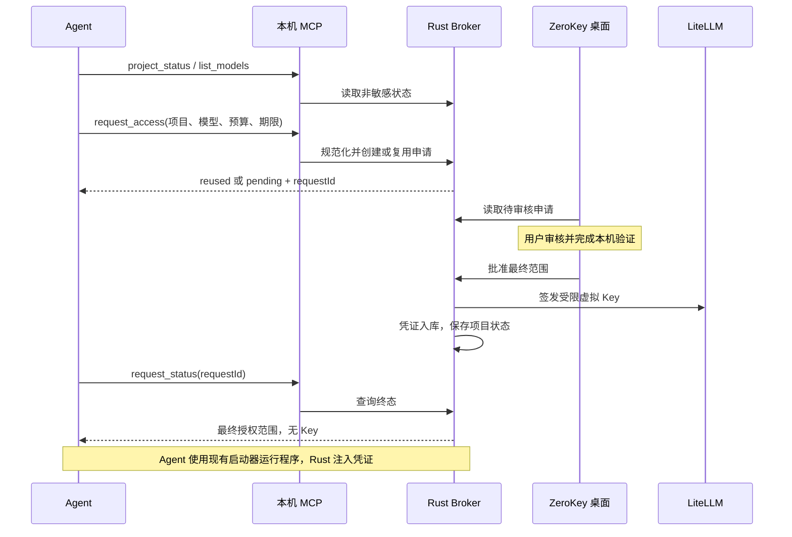

# ZeroKey Agent 接入设计

状态：2026-11-17 已实现本机 stdio MCP、8 个工具、异步原生申请队列、托盘审核和 Skill 指引。使用与测试方式见 [MCP 接入](mcp.md)。设置页可合并客户端配置，分别显示实际配置、握手与工具发现状态。

## 推荐方式

采用 **本机 MCP + 简短 Skill + 原生程序启动器**。MCP 提供可发现、结构化的工具；Skill 告诉 Agent 何时复用授权、如何选模型及运行程序；桌面 Broker 继续负责人工确认、凭证存储与注入。三者共用同一份项目授权。

| 方式        | 适合的工作                                   | 在 ZeroKey 中的定位                       |
| ----------- | -------------------------------------------- | ----------------------------------------- |
| Skill + CLI | 已有终端能力的编码 Agent，安装简单           | 现有路径继续可用，也是 MCP 不可用时的后备 |
| MCP         | 多客户端接入、自动发现工具、可靠解析申请状态 | 已实现的结构化入口                        |
| 程序启动器  | 为脚本或服务在启动时注入项目凭证             | 两种 Agent 入口共用，继续由 Rust 执行     |

用户体验是：“给当前项目配置够用的文字模型” → Agent 查询或复用 → 首次或变更时在 ZeroKey 审核 → Agent 通过启动器运行任务。默认长期有效，日常运行不用再次确认。

MCP 返回的数据会进入 Agent 上下文，不能通过 MCP 返回 Key。MCP 子进程也不能替 Agent 的父进程设置环境变量，因此“授权成功”与“程序已经获得运行环境”必须明确区分：获得凭证的程序仍需通过启动器启动。

## 复用现有实现

| 当前代码                  | 已有能力                                                   | 本轮实现                                   |
| ------------------------- | ---------------------------------------------------------- | ------------------------------------------ |
| `scripts/zerokey.ts`      | `doctor`、`models`、`status`、`provision`、`run`           | 可复用的 Broker 调用模块；保留原 CLI       |
| `src-tauri/src/broker.rs` | 原生凭据库、路径规范化、有效授权复用、申请文件、十分钟等待 | 非阻塞申请与查询、取消、终态保留、并发控制 |
| 托盘与独立审核窗口        | 单项目选择、模型/来源/理由多选、预算/期限、原生确认        | 主窗口隐藏仍能审核；取消失效时隐藏窗口      |
| `skills/provision-key`    | 查询后复用、首次审批、无明文 Key 的启动流程                | MCP 可用时优先工具；不可用时使用原 CLI     |

MCP 层不持有网关管理 Key，也不调用 LiteLLM 的管理 API。原始来源凭证和虚拟 Key 继续由网关与 Rust 管理。

## 第一版工具

采用本机 stdio 传输，由每个 Agent 客户端启动一个轻量 TS 进程。第一版不启动 HTTP 监听，也不增加 Docker 服务。共享状态与并发规则放在 Broker，不能仅靠某个 MCP 进程内的变量。

工具统一返回结构化结果和简短文本；标准输出只用于 MCP 协议，诊断写标准错误，且不输出原始网关响应或凭证。

| 工具                     | 输入                                                               | 结果                                                        |
| ------------------------ | ------------------------------------------------------------------ | ----------------------------------------------------------- |
| `zerokey_health`         | 无                                                                 | Broker 版本、网关连接、桌面是否可处理申请、检查时间         |
| `zerokey_list_models`    | 可选 `source`、`query`、`cursor`、`limit`                          | 分页目录：模型 ID、来源、接口协议、下一页游标、目录更新时间 |
| `zerokey_project_status` | 绝对 `projectPath`                                                 | 授权状态、模型、每日预算、到期时间、凭证是否存在、检查时间  |
| `zerokey_request_access` | `projectPath`、`appName`、`models`、`dailyBudget`，可选 `duration` | `reused` 或 `pending`，申请编号与审批截止时间               |
| `zerokey_request_status` | `requestId`                                                        | 申请状态；成功时返回最终获批范围及启动器指引                |
| `zerokey_cancel_request` | `requestId`                                                        | 幂等取消尚未进入签发阶段的申请；终态不改变                  |
| `zerokey_wait_request` | `requestId`、`afterStatus`、`timeoutSeconds` | 等待变化，超时返回当前状态 |
| `zerokey_project_setup` | `projectPath`，可选 `model` | 无密钥模板及首次调用命令 |

目录默认每页 20 条，最多 100 条；不把全部模型和后台配置一次性塞进上下文。目录只声明协议，不把“列出”当作“实测可用”。保留来源前缀，OpenCode Go 与余额付费分别列出；不自动启用付费回退。

每日预算沿用当前 Broker 的约束：大于 $0、不超过 $10。省略 `duration` 表示长期有效；临时授权明确传 `7d` 等值。不接受空模型列表、通配符、PIN、网关管理 Key 或任意额外凭证字段。

返回项目数据使用白名单字段，排除 `keyHash`、任何明文 Key、PIN、本机凭据库条目、上游端点与管理配置。`requestId` 只是查询标识，不是取用凭证的通行证。

状态读取失败返回明确错误和可选的上次检查时间；不把旧的 active 记录当作已验证有效。凭证存在也不代表预算可用。用量若加入返回值，须附检查时间与网关预算周期，不能把来源套餐余量和网关估算混为一谈。

## 申请生命周期



申请立即返回，不等待用户操作。Agent 使用最长 30 秒的 `wait_request` 等待同一申请变化，超时后可继续等待；用户取消或申请过期后停止，不自动重新弹窗。托盘内的原生队列检查独立于隐藏的前端，不依赖浏览器后台定时器。

申请状态：`pending` → `authorizing` → `provisioned` / `reused` / `failed`；`pending` 也可进入 `canceled` / `expired`。`authorizing` 是 Broker 持有签发锁后的真实阶段；不能在仍可能签发时回报“已经取消”。如果正在本机验证，取消结果应明确仍在处理中，等待确定终态。

**审批窗口与 Key 有效期独立。** 申请可以沿用十分钟的审核窗口；用户批准后生成的 Key 默认不设到期时间。申请过期后，在真正签发前仍需重新检查截止时间。

相同有效授权直接复用。相同项目、排序去重后的模型集合、预算、期限对应同一个待审核申请；重复调用返回同一编号。一个项目已有不同范围的待审核申请时返回 `REQUEST_CONFLICT`，让 Agent 查询或明确取消后再提交，避免弹出一串重复申请。

项目身份沿用 Rust 的真实路径规范化与 Windows 大小写处理，不能让 TS 和 Rust 各算一份身份。幂等检查、状态转换与签发必须由跨进程锁或等效的原子操作保护。桌面手动授权、多个 Agent 和 CLI 都遵循相同规则。

用户在独立窗口选择一个项目，并可调整来源、模型、理由、预算与期限。点击确认后审核窗口隐藏，再进入 Windows Hello。MCP 返回**最终获批**范围及 `changes` / `changeSummary`；原申请范围保持不变。Agent 对照任务需求再继续，不能假设初始请求全部获批。可重试的验证失败恢复表单并保留输入，明确放弃或无法恢复的错误才进入终态。

终态建议保留 24 小时，支持 Agent 重连后继续查询，不能像当前阻塞 CLI 一样读一次就删除结果。旧 CLI 的 `provision` 应改为调用同一个非阻塞接口并等待查询结果，保留现有使用方式。

## 程序如何使用授权

第一版沿用：

```text
node <ZeroKey安装路径>/scripts/zerokey.ts run --project <项目绝对路径> -- <程序> <参数...>
```

启动器在目标项目目录启动程序，注入 `OPENAI_API_KEY` / `LLM_API_KEY`、网关地址、模型、`LLM_API_PROTOCOL` 和 `LITELLM_SESSION_ID`。脚本只从环境读取所需变量；不打印完整环境，不把凭证写到代码、项目 `.env` 或 Agent 配置。`project_setup` / CLI `init` 提供 Chat Completions 与 Responses 模板，`verify` 使用真实授权完成一次短文本调用。

OpenCode Go 请求携带 `x-litellm-session-id`，同一对话内保持一致；跨程序可使用现有 `--session-id`。模型目录声明 `responses`、`messages`、`chat-completions` 等协议，不自动转换为所有协议都可用。

第一版 MCP 不提供任意命令执行工具。编码 Agent 使用自己的终端能力运行启动器，进程输出与 MCP 协议保持分离。目标程序能够读取注入的凭证，若它自己打印环境仍会泄露；不能承诺任意子进程输出都天然安全。

只有 MCP、没有终端的客户端可以管理授权，但第一版不能直接启动项目程序。若之后需要纯 MCP 的文字推理，再增加受项目授权约束、正确适配协议的推理工具；这会产生模型费用，应作为独立功能实现与验证。

## Skill 的职责

保留 `provision-key` 名称。Skill 只记录工作策略和少量入口：

1. 先确定当前项目，查询状态；已有满足任务需求的有效授权就复用，不重设预算、模型或期限。
2. 需要新模型或权限变化时查询目录，选择明确模型，提交申请；告知用户在桌面审核，不代输 PIN 或确认。
3. 查询已有申请至终态；取消后停止，不通过换编号或重试绕过。
4. 获取最终获批范围后，用本机启动器运行任务；不尝试从 MCP、配置文件或凭据库读取 Key。
5. MCP 不可用时走已有 CLI。已提交申请的 MCP 若中途断开，先恢复原编号；不能直接切换后备入口重新创建。

Skill 应先检测实际可用工具；MCP 上线前不改现有 Skill 去调用不存在的接口。后续安装器生成实际入口路径，解决现有 Skill 固定开发目录的问题。每个客户端使用自己的配置格式，不把一份配置直接覆盖所有客户端的现有文件。

## 本机范围与错误恢复

- MCP 本身不要求用户复制任何 Key；客户端只配置本机可执行入口。stdio 限制网络暴露，但不隔离同账号恶意进程。
- 项目路径与客户端显示名属于声明信息，不是强认证。若客户端支持 roots，作为默认项目选择与范围提示；真正的路径规范化和审核仍由 Broker 完成。
- 桌面未启动时返回 `DESKTOP_NOT_RUNNING` 和打开提示；不会静默签发。使用桌面进程持有的操作系统文件锁检测运行状态，退出或崩溃后自动释放，不能靠一个陈旧文件认定应用在线。
- 网关不可达返回 `GATEWAY_UNAVAILABLE`；凭据缺失返回 `CREDENTIAL_MISSING`；模型不在目录返回 `MODEL_UNAVAILABLE`；请求过期和取消给出独立终态。
- 首版不暴露管理来源、读取凭证、修改 PIN、批准申请或撤销全部授权的工具。项目撤销仍由桌面明确操作。
- 人工确认、取消和失效检查必须由 Rust 执行。Skill 指令和 MCP 的工具注解只能帮助 Agent 理解，不能替代权限检查。

## 实施顺序与验收

1. **拆分原生申请接口。** 新增 request / request-status / request-cancel，兼容原 `provision`；测试跨进程重复请求、冲突、超时与签发竞态，不触碰实际来源凭证。
2. **接入 TS stdio MCP。** 依赖显式写入包配置，复用原生 Broker，固定输入与输出结构。通过协议客户端验证初始化、工具发现、输入校验、无关字段不进入输出、重连查询与取消。
3. **收敛 Skill 与安装。** MCP 优先、CLI 后备，生成实际安装路径；按 Codex / Claude Code / OpenCode 分别生成可检查的配置片段，确认客户端能力后再修改用户配置。
4. **完整人工验收。** 在实际使用的 Agent 中提交首次申请，由用户本人完成桌面确认；验证第二次复用、变更再次审核、取消不重试、程序正常输出、Go 会话保持。跨平台构建单独验证，不把 Windows 结果当作 macOS/Linux 已完成。

自动验证使用模拟网关和测试凭据适配器；真实签发与文字调用另行记录消耗和撤销结果。发布前确认 Agent 对话与 MCP 响应只包含模型、预算、期限和状态；不能仅凭日志中搜索不到某个 Key 就宣称所有泄露路径已被排除。
